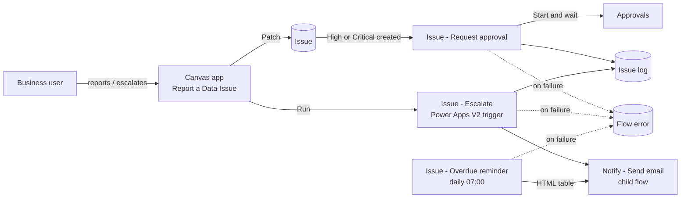
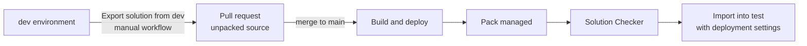

# Data Issue Desk

A Power Platform solution for reporting, approving and following up on data quality issues.
Business users report an issue from a canvas app, high and critical issues go through an approval,
anyone can escalate from the app, and the data team gets a daily overview of what is overdue.
The whole solution lives in source control and is deployed to a test environment by GitHub Actions.


## What is in it

| Layer | What | Where |
|---|---|---|
| **Dataverse** | 4 tables, 3 global choices, lookups with cascade rules, an alternate key, 3 environment variables | `scripts/setup-dataverse.ps1`, `solution/` |
| **Canvas app** | Responsive app: issue list with status tabs and search, report form with validation, detail screen with a status timeline and an Escalate action | `src/canvas/`, `solution/` |
| **Power Automate** | 4 solution-aware cloud flows with try/catch scopes, a child flow, environment variables and connection references | `src/flows/`, `solution/` |
| **ALM** | Export and unpack from dev, pack as managed, Solution Checker, import into test with deployment settings | `.github/workflows/`, `deployment/` |

## How it works



### Data model

| Table | Purpose |
|---|---|
| **Data source** | System that holds the data, its owner and criticality. Alternate key on name. |
| **Issue** | Title, description, impact, severity, status, reporter, reported and resolved dates. |
| **Issue log** | Audit trail: from status, to status, when, comment. Cascade-deleted with the issue. |
| **Flow error** | Written by the catch scope of every flow: flow name, run URL and error details. |

Choices: *Severity* (Low, Medium, High, Critical), *Issue status* (New, Awaiting approval, Approved, Rejected, Resolved), *Criticality*.
Environment variables: *Approver email*, *Data team mailbox*, *Overdue after (days)*.

### Cloud flows

| Flow | Trigger | What it does |
|---|---|---|
| **Issue \| Request approval** | Dataverse: issue created with severity High or Critical (filter on the trigger) | Sets the status to *Awaiting approval*, starts an approval with the details in markdown, writes the outcome and the approver's comment to the issue log |
| **Issue \| Escalate** | Power Apps (V2) with issue id and reason | Logs the escalation, emails the data team through the child flow, responds to the app |
| **Issue \| Overdue reminder** | Recurrence, every morning at 07:00 | Lists open issues older than *Overdue after (days)* and sends them as an HTML table |
| **Notify \| Send email** | Child flow | One place that sends email, so the mail connector can be swapped without touching the other flows |

Every flow follows the same pattern: a **Try** scope with the work and a **Catch** scope that runs on failure or timeout,
logs the run to the *Flow error* table with a link to the run, and ends the run as failed.

### Canvas app

- Named formulas in `App.Formulas` for the theme and the current user
- Responsive layout with auto-layout containers, no fixed screen size
- Delegable `Filter` and `SortByColumns` on Dataverse
- Validation before `Patch`, errors handled with `IfError` and shown with `Notify`
- Calls the Escalate flow and refreshes the timeline afterwards

## ALM



- **Export solution from dev** exports the unmanaged and managed solution, unpacks both to `solution/` (canvas app included) and opens a pull request.
- **Build and deploy** packs a managed solution from source, runs the Solution Checker, and imports it into test using `deployment/test-settings.json` for environment variable values and connection references.
- Authentication is a service principal (app registration with an application user in each environment), set up by `scripts/setup-alm.ps1`.

## Set it up yourself

Requirements: a Power Platform environment with Dataverse and Windows PowerShell 5.1 or later. No modules needed; the scripts sign in with a device code.

```powershell
# 1. Tables, choices, environment variables and sample data
.\scripts\setup-dataverse.ps1 -EnvironmentUrl https://yourorg.crm.dynamics.com -TenantId <tenant-id>

# 2. Connection references and cloud flows
.\scripts\deploy-flows.ps1 -EnvironmentUrl https://yourorg.crm.dynamics.com -TenantId <tenant-id> -TeamMailbox you@example.com

# 3. Service principal for GitHub Actions (prints the secrets to add to the repository)
.\scripts\setup-alm.ps1 -DevEnvironmentUrl https://yourorg.crm.dynamics.com -TestEnvironmentUrl https://yourtest.crm.dynamics.com -TenantId <tenant-id>
```

Then link the connection references to your connections and turn the flows on. Or import the solution from `solution/` with the Power Platform CLI.

## Repository layout

```
.github/workflows/   export and build/deploy pipelines
data/                sample data (5 data sources, 30 issues, 51 log rows)
deployment/          deployment settings for the test environment
scripts/             setup and deploy scripts (Dataverse Web API)
solution/            the unpacked solution, exported from dev
src/canvas/          canvas app screens as YAML
src/flows/           cloud flow definitions
```
